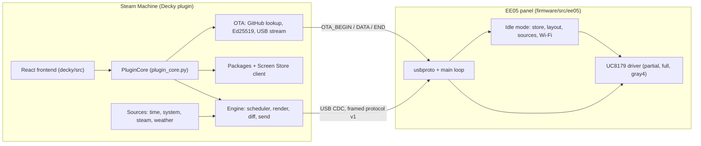
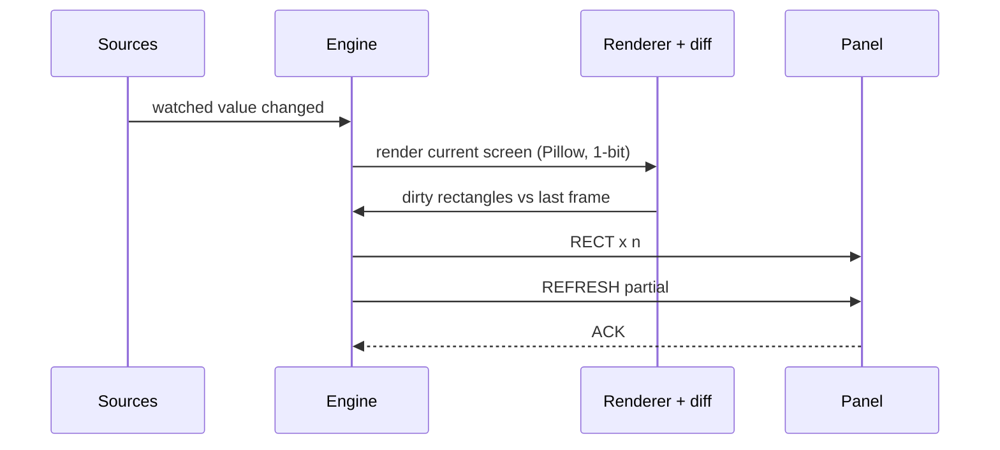
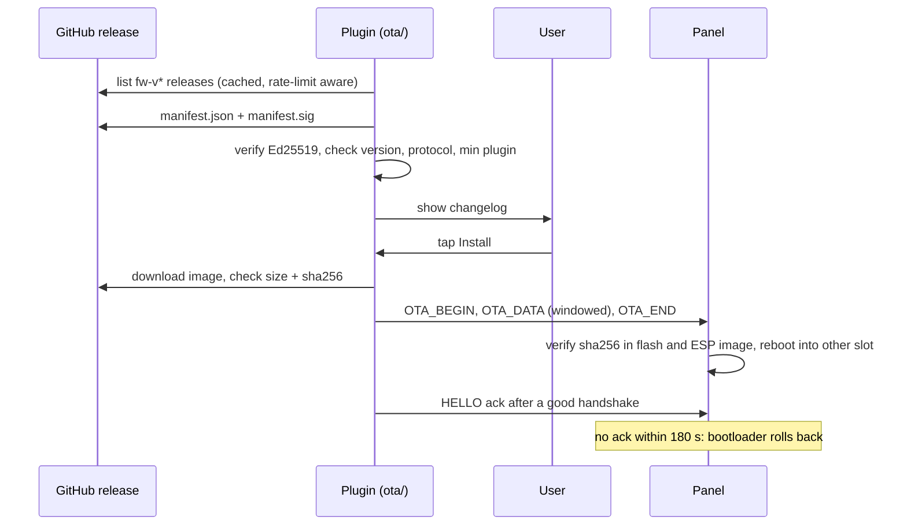

# Design: Inkterface v1

How the requirements in `requirements.md` are met by the code in this repository. The detailed references are in
`docs/` (indexed in `docs/README.md`); this file is the map.

## Overview

Two programs share one USB serial link.

- **Host**: a Decky Loader plugin on the Steam Machine. A Python core (standard library plus vendored Pillow) renders
  screens, diffs frames and speaks the protocol. A thin `decky/main.py` and a React frontend expose it in Gaming Mode.
- **Panel**: firmware for the Seeed XIAO EE05 (ESP32-S3). In active mode it is a framebuffer with a fast partial-refresh
  driver. In idle mode it draws a stored layout by itself and pulls data over Wi-Fi.

## Components

| Component | Where | Responsibility |
|-----------|-------|----------------|
| Frame codec | `decky/py_modules/inkterface_core/proto.py`, `firmware/src/ee05/usbproto.cpp` | Frame build and parse, CRC32, resync. Same wire format on both sides, compared byte for byte in tests |
| Serial and link | `serialport.py`, `usb_link.py`, `serial_ports.py` | Raw tty through `os`/`fcntl`/`select`, panel discovery by VID `303a` through sysfs, ACKed sends |
| Dirty rectangles | `diff.py` | Diff two 1-bit frames into rectangles aligned to 8 pixels, split to fit 4096 byte payloads |
| Emulator | `emulator.py` | Firmware-equivalent receiver used by tests and by `decky/tools/run_engine.py` to produce PNGs |
| Engine | `engine/` | Settings, scheduler (pin, rotation, in-game list, Now Playing), render, diff, send loop, ghost-clear policy, sleep and wake, idle upload |
| Screens | `screens/` | `screen.json` validator, widget renderer, fonts (Inkterface Mono), icons, `emulate` CLI |
| Sources | `sources/` | Host data: time, system, local Steam, Steam Web API, weather. Change events wake the engine |
| Packages | `packages/` | Zip import checks, approval store, sandboxed `screen.py` runner |
| Catalog | `catalog/` | Signed Screen Store index client: signature before parse, serial rollback refusal, size and sha256 checks |
| Idle compiler | `idle/` | Compile the `idle` section of a screen to the panel's layout store, plan rotation, preview |
| OTA | `ota/`, `firmware.py` | GitHub release lookup with cache and rate-limit handling, Ed25519 verification, manifest policy, streaming install |
| Plugin wiring | `plugin_core.py`, `decky/main.py`, `decky/src/` | Callables and events for the UI; pages Live, Standby, Store, Firmware, Settings, About |
| Panel firmware | `firmware/src/ee05/` | USB protocol, UC8179 driver (`uc8179_fast.h`, `fastpartial.h`), idle layout store, painter, sources, OTA receiver |
| Release tooling | `tools/release/`, `.github/workflows/` | Key generation, manifest signing, offline verification, release workflows |

## Protocol (v1)

Frame: `A5 5A | type | seq | len u16 | payload | crc32`, little endian, `len` up to 4096. Full definition:
`docs/usb-protocol-v1.md`.

| Type | Name | Direction | Use |
|------|------|-----------|-----|
| 0x01 | HELLO | both | Host sends it empty to request one; panel answers with versions, size, capability bits and free idle flash; host sends a HELLO ack after an OTA |
| 0x02 | HEARTBEAT | host to panel | Sent after 5 s of silence; any frame counts as liveness |
| 0x03, 0x04 | ACK, NAK | panel to host | Carry the `seq` of the frame they answer |
| 0x10 | RECT | host to panel | 1-bit rows into the panel framebuffer (`x`, `w` multiples of 8) |
| 0x11 | REFRESH | host to panel | `0` partial, `1` full |
| 0x12 | MODE | host to panel | Host or panel mode, idle timeout and layout |
| 0x20 | IDLE_LAYOUT | host to panel | Chunked upload of the compiled idle store |
| 0x30 to 0x32 | OTA_BEGIN, OTA_DATA, OTA_END | host to panel | Windowed firmware stream |
| 0x7F | LOG | panel to host | Text line |

The panel's USB receive queue has no back-pressure, so the host windows its writes (`rx_window` in HELLO).

## Active mode data flow

Refresh policy: first frame, screen switch, reconnect and resync use a full refresh. Otherwise a partial refresh, with a
time-and-count gated full refresh at a quiet moment to clear ghosting (`docs/ghost-clear.md`). The fast partial waveform
is a single-phase drive built by `fastpartial.h`, with `VCOM_DC` tuned so unchanged pixels see a neutral field
(`docs/partial-refresh.md`).

## Idle mode data flow

1. While the host is alive the engine compiles the enabled idle screens and uploads them as IDLE_LAYOUT frames when
   they change, and sends the idle timeout in `MODE HOST`.
2. The panel stores the layout set in flash (`idle_store.cpp`). The upload is refused if it does not fit the free flash
   it reported in HELLO.
3. After `idle_timeout_s` without a host frame the panel enters idle: it connects to Wi-Fi without blocking USB,
   polls its sources (`clock`, `weather`, `steam`, `http_json`), paints the layout (`idle_painter.cpp`) and rotates layouts.
4. The first valid host frame returns the panel to active mode and the host sends a full frame.

## Screen packages

A package is `<id>/screen.json` plus `assets/` and an optional `screen.py`. The validator in `screens/schema.py` is the
single definition of the format (`docs/screen-format.md`). Two tiers: declarative (no code runs) and code (disabled
until the exact sha256 is approved, then run in a separate `python -I` process with an empty environment, a 2 s timeout
and resource limits; this is a guardrail, not a sandbox, and the docs say so). Built-in screens in `decky/screens/` are
declarative and covered by golden images.

## Firmware OTA

The public key is bundled in the plugin (`ota/trust.py`). The panel does not verify signatures: the signature protects
the update path from GitHub, not the panel from local access. The Screen Store catalog uses a separate key.

## Error handling

- NAK from the panel: the engine abandons the rest of the batch, records `last_error`, and resyncs with a full frame.
- Protocol mismatch: the link is closed, no frames are sent, and the plugin points to the firmware update.
- Source failure: reported as data to the screen. A failed panel fetch keeps the last good values.
- Corrupt settings file: defaults plus an error string, the bad file moved to `.corrupt`.
- Corrupt `state.json` of the package store: moved to `state.json.bad`, the store starts empty and approvals are forgotten.
- Failed or hung code screen: an error screen is drawn, the plugin is unaffected.
- OTA: any failed signature, hash or size check aborts before the panel is touched; power loss mid-write leaves the old slot intact.

## Testing strategy

| Area | Where | What |
|------|-------|------|
| Protocol | `decky/tests/test_proto.py`, `test_proto_numbering.py`, `test_cpp_diff.py` | Codec round trips, resync, host and firmware parsers compared byte for byte |
| Dirty-rect diff | `decky/tests/test_diff.py`, `test_fastpartial_host.py` | Alignment, splitting, edge cases, partial-refresh drive |
| Engine and plugin | `decky/tests/engine/`, `decky/tests/plugin/` | Scheduler, ghost policy, NAK handling, sleep and wake, callables with a fake `decky` and an emulated panel |
| Screens and idle | `decky/tests/screens/`, `decky/tests/idle/`, `decky/tests/packages/`, `decky/tests/catalog/` | Schema, golden PNGs (host emulator and firmware renderer), zip import limits, approval, signed catalog |
| OTA | `decky/tests/ota/`, `test_ota_cpp.py`, `test_ota_plugin.py` | Ed25519 vectors, manifest policy, GitHub failures, streamer against the emulator, firmware state machine, power loss, rollback; 90 percent coverage gate in CI |
| Frontend | `decky/test/` | vitest with mocked `@decky/api` and `@decky/ui`, plus `tsc --noEmit` |
| Firmware | `firmware/host_test/` | C++ host tests with address and undefined-behaviour sanitizers, plus `pio run -e ee05` in CI |
| Repository hygiene | `decky/tests/test_repo_paths.py`, `test_file_sizes.py`, `test_version.py`, `test_license.py` | Doc links, 2 MB cap, version agreement, licence notices |
| Real hardware | `decky/tools/` and the checklist in `requirements.md` (Requirement 10) | Bench tools open the real panel and follow the rules in `.kiro/steering/device-safety.md` |

## Changes from the 10 November design

The v1 design left several items open for a protocol and firmware spike. What was decided and built:

| Topic | Design | Built |
|-------|--------|-------|
| Display driver | GxEPD2 or direct UC8179 (open) | Bare-metal UC8179 driver; no GxEPD2 in any build environment |
| Handshake | HELLO probe method open | The host's empty HELLO requests a HELLO; panel announces itself only when no host session is alive |
| Partial refresh time | 1.8 s with the stock waveform, target under 1 s | Single-phase fast waveform, median about 0.7 s on a real panel |
| 4-gray idle | Waveform source open | The controller's own OTP waveform, selected with two register writes; no third-party bytes in the repository |
| Idle Wi-Fi and Steam settings | Carrier open | Config section of the idle store, pushed over USB; stored unencrypted in panel flash (documented limit) |
| Community screens | Git catalog planned for v2 | Screen Store with a signed catalog is in v1; zip or URL import stays as a developer feature |
| Plugin settings | Format open | One atomic JSON file, validated all-or-nothing |
| Idle rotation | Location open | Rotation is part of the uploaded layout set, held by the panel |
| OTA | `manifest.sig` encoding open | Ed25519 signature over the manifest bytes; verified before the manifest is parsed |
