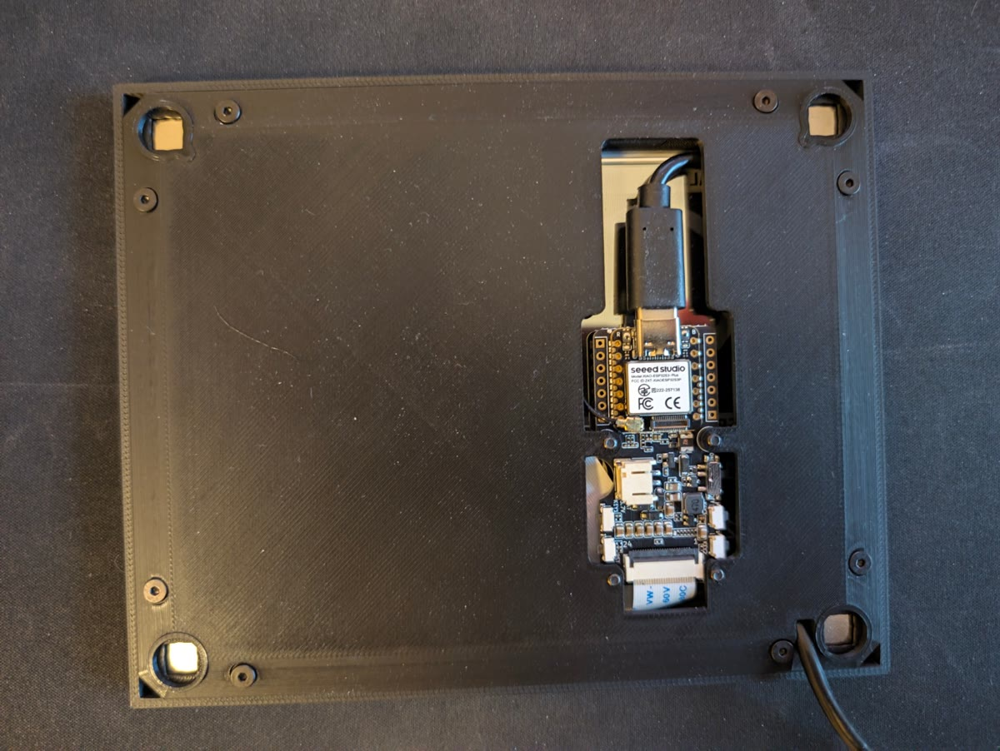

# Hardware

What you need to build an Inkterface panel for the Steam Machine, and how it goes together.
The parts list is generated from [`hardware/bom.yaml`](../hardware/bom.yaml) by `tools/gen_bom.py`; edit the links there,
not in this file.

## Bill of materials

<!-- gen:bom -->
| Qty | Part | Spec | Where to buy | AliExpress | Notes |
|----:|------|------|--------------|------------|-------|
| 1 | XIAO ePaper Display Board (ESP32-S3) EE05 | Seeed EE05, ESP32-S3, 24-pin FPC connector for the panel, USB-C | [Seeed](https://www.seeedstudio.com/XIAO-ePaper-Display-Board-EE05-p-6755.html?sensecap_affiliate=dlPNUD2&referring_service=link) / [OpenELAB](https://openelab.io/products/seeed-studio-xiao-epaper-board-ee05) | [AliExpress](https://s.click.aliexpress.com/e/_c43WvPXd) | Runs the Inkterface firmware. USB powered. |
| 1 | 5.83" monochrome ePaper display | 648x480 pixels, UC8179 controller, FPC cable | [Seeed](https://www.seeedstudio.com/5-83-Monochrome-ePaper-Display-with-648x480-Pixels-p-5785.html?sensecap_affiliate=dlPNUD2&referring_service=link) / [OpenELAB](https://openelab.io/products/goodisplay-5-83inch-e-paper) | [AliExpress](https://s.click.aliexpress.com/e/_c3zLNr7N) | Plugs straight into the EE05 FPC connector. No soldering. The flex cable is fragile. |
| 4 | Magnets | 10 x 10 x 4 mm | Amazon [PL](https://www.amazon.pl/dp/B075P5M649?tag=flieswithwind-21) · [DE](https://www.amazon.de/dp/B075P5M649?tag=flieswithwi04-21) · [FR](https://www.amazon.fr/dp/B075P5M649?tag=flieswithwi0f-21) · [ES](https://www.amazon.es/dp/B075P5M649?tag=flieswithwi0a-21) · [IT](https://www.amazon.it/dp/B075P5M649?tag=flieswithwi0d-21) · [UK](https://www.amazon.co.uk/dp/B075P5M649?tag=flieswithwi07-21) · [US](https://www.amazon.com/dp/B0H3TFLG55?tag=flieswithwind-20) | [AliExpress](https://s.click.aliexpress.com/e/_c3g72c8j) | One per corner of the midplates. Orientation does not matter. |
| 13 | M2.5x5 flat head hex socket screw (304 stainless) | M2.5 thread, 5 mm long, flat head, hex socket | Amazon [PL](https://www.amazon.pl/dp/B0G6ZCMST1?tag=flieswithwind-21) · [DE](https://www.amazon.de/dp/B0G6ZCMST1?tag=flieswithwi04-21) · [FR](https://www.amazon.fr/dp/B0G6ZCMST1?tag=flieswithwi0f-21) · [ES](https://www.amazon.es/dp/B0G6ZCMST1?tag=flieswithwi0a-21) · [IT](https://www.amazon.it/dp/B0G6ZCMST1?tag=flieswithwi0d-21) · [UK](https://www.amazon.co.uk/dp/B0G6ZCMST1?tag=flieswithwi07-21) · [US](https://www.amazon.com/dp/B0G6ZCMST1?tag=flieswithwind-20) | [AliExpress](https://s.click.aliexpress.com/e/_c2Izsl8P) | Threaded straight into the printed plastic. |
| 1 | USB-C to USB 2.0 cable, 0.5 m | USB-C plug to USB-A 2.0 plug, data and power | Amazon [PL](https://www.amazon.pl/dp/B07NSQ56DP?tag=flieswithwind-21) · [DE](https://www.amazon.de/dp/B07NSQ56DP?tag=flieswithwi04-21) · [FR](https://www.amazon.fr/dp/B07NSQ56DP?tag=flieswithwi0f-21) · [ES](https://www.amazon.es/dp/B07NSQ56DP?tag=flieswithwi0a-21) · [IT](https://www.amazon.it/dp/B07NSQ56DP?tag=flieswithwi0d-21) · [UK](https://www.amazon.co.uk/dp/B07NSQ56DP?tag=flieswithwi07-21) · [US](https://www.amazon.com/dp/B07NSQ56DP?tag=flieswithwind-20) | [AliExpress](https://s.click.aliexpress.com/e/_c4noGSGL) | From the EE05 to a USB port on the Steam Machine. Must carry data, not charge-only. |
<!-- /gen:bom -->

<!-- gen:affiliate -->
**Affiliate links.** Some store links in the parts list are affiliate links: if you buy through them, the project may earn a small commission at no extra cost to you. As an Amazon Associate I earn from qualifying purchases.
<!-- /gen:affiliate -->

The firmware in `firmware/src/ee05/` drives the UC8179 panel controller directly with a custom fast
partial-refresh path ([partial-refresh.md](partial-refresh.md)); it links no display library.
The board is powered over USB; there is no battery.

The original Adafruit ESP32-S3 Feather + eInk Breakout Friend build (Bluetooth + Qt app) does not work with the plugin
and is not in this repository. See [License and credits](../readme.md#license-and-credits).

## Enclosure

<!-- gen:printed -->
The enclosure is a remix of [Valve's Inkterface case](https://gitlab.steamos.cloud/SteamHardware/SteamMachine/inkterface), modified for the EE05. Its print files are on [Printables](https://www.printables.com/model/1897091-inkterface-e-ink-faceplate-for-the-steam-machine-s) under CC BY-NC-SA 4.0. Valve's original design is MIT (Copyright (c) 2026 Valve Software), see THIRD_PARTY_NOTICES.md and Valve's GitLab repository.
<!-- /gen:printed -->

Credit: the original enclosure design is Valve's, shared under the MIT licence in [LICENSE](../LICENSE)
("Copyright (c) 2026 Valve Software"); Valve's repository has their original files. The EE05 remix is published
separately under CC BY-NC-SA 4.0. The code in this repository stays MIT.

## Assembly

Valve's assembly guide documents the original Feather build: the
[video](https://gitlab.steamos.cloud/SteamHardware/SteamMachine/inkterface/-/blob/477563c/docs/Inkterface%20Assembly.mp4) and the
[PDF](https://gitlab.steamos.cloud/SteamHardware/SteamMachine/inkterface/-/blob/477563c/docs/Inkterface%20Assembly.pdf)
live in Valve's repository. The mechanical steps are the same for the EE05, the electrical steps are simpler.

**_Warning: The screws will thread themselves into the plastic, but be VERY gentle
as it is easy to strip the plastic away and you may need to re-print parts!_**

1. Print the enclosure parts (see Enclosure above).
2. Plug the panel's flex cable into the EE05's FPC connector. No soldering is needed.
    * Be careful with the flex that comes out of the panel, it is fragile and must not be bent or folded.
3. Place the e-ink panel into the matching recess in the faceplate part.
4. Fit the two midplates in.
5. Place the 4 magnets into the recesses in each corner of the midplates.
    * Magnetic field orientation doesn't matter, they connect to metal slugs in the Steam Machine chassis.
6. Place the board plate over the midplates, aligning the magnets and screw holes.
7. Fasten the board plate with screws in the screw holes along the edges.
8. Mount the EE05 on the board plate.
9. Plug in the USB cable and route it under the Steam Machine so it stays hidden.

Once assembled it is solid and magnets to the front of a Steam Machine. Flash the firmware
([flashing.md](flashing.md)) before first use.
