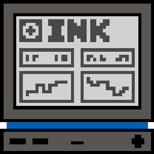
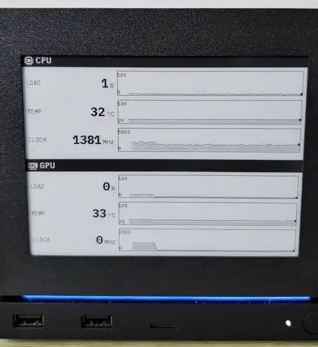
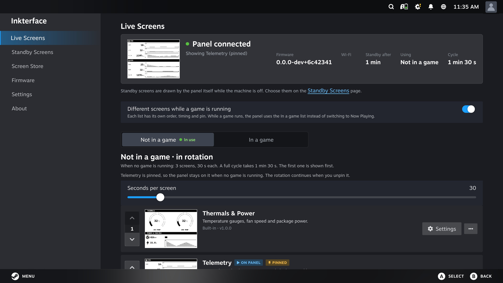
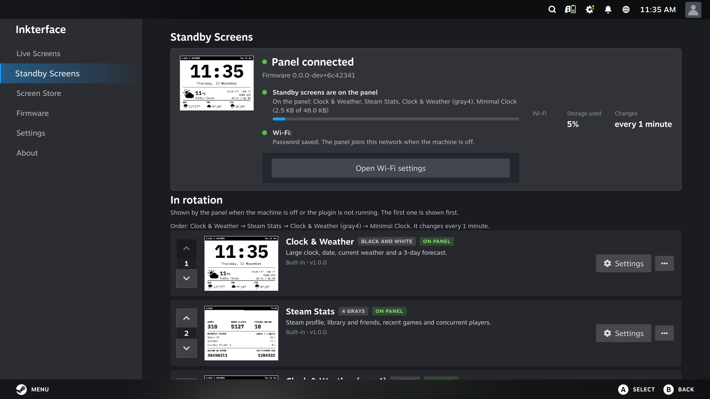
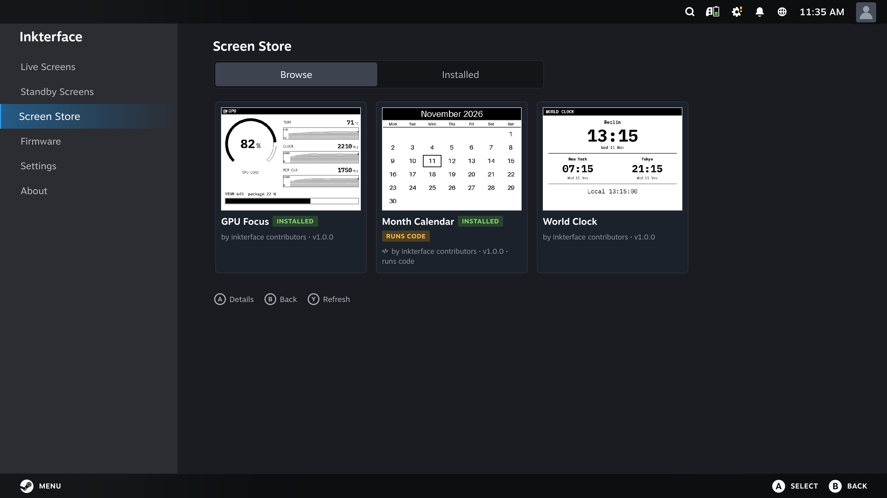
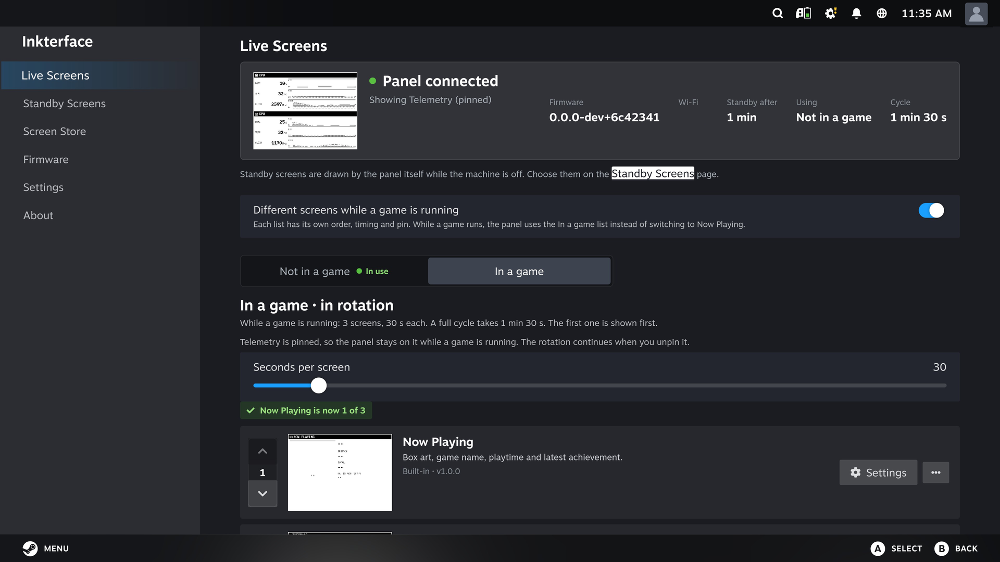
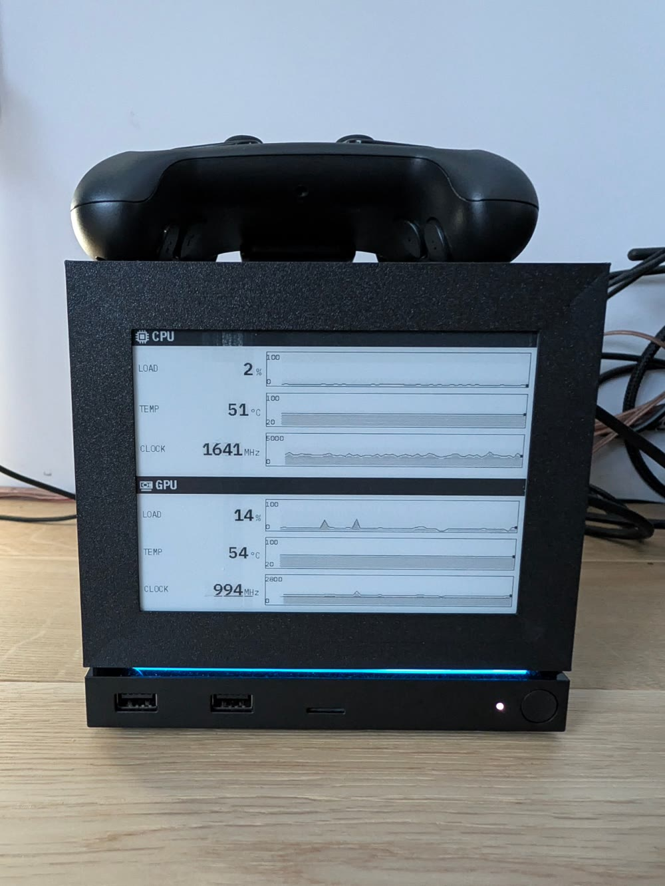
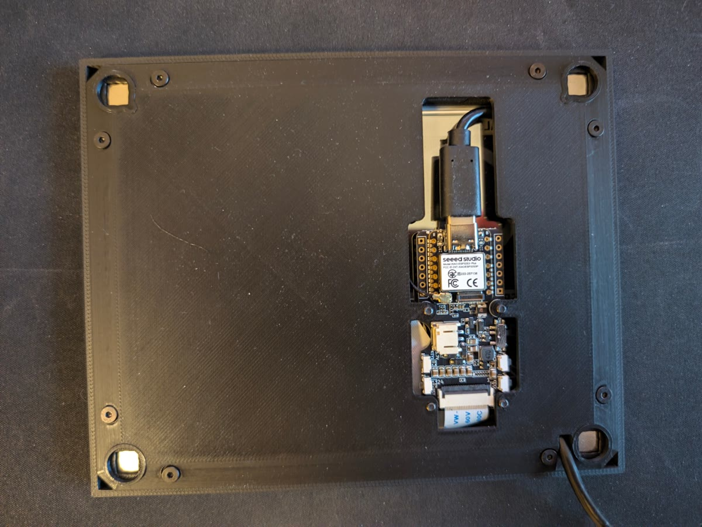

<p align="center"><br>
</p>

# Inkterface

An e-ink faceplate for the Steam Machine. A 5.83" 648x480 e-paper panel magnets onto the front of the
machine and shows live system stats, what you are playing, a clock and more. It is a
[Decky Loader](https://decky.xyz) plugin plus custom firmware for the Seeed XIAO ePaper Display Board EE05,
connected by one USB cable.

Based on [Valve's original Inkterface](https://gitlab.steamos.cloud/SteamHardware/SteamMachine/inkterface). See [Origin](#origin).

Status: **1.0.0-beta.2**. The test suites are green, and the plugin has run against a real panel on a real
Steam Machine in Gaming Mode. What changed and what is limited: [CHANGELOG.md](CHANGELOG.md). All docs: [docs/README.md](docs/README.md).

> ⚠️ **Beta.** Inkterface is beta software and hardware. Expect bugs, rough edges and changes between releases.
>
> **Use at your own risk.** This is a hobby project, provided as is, with no warranty of any kind (see [LICENSE](LICENSE)). The author is not responsible for any damage to your Steam Machine, the display, the EE05 board, USB ports or any other hardware, or for any data loss, from building, flashing or using it.

<!-- gen:support -->
## Support

Inkterface is free and open source. If it is useful to you, you can support its development on [Ko-fi](https://ko-fi.com/inkterface).

[](https://ko-fi.com/W7W72AIPDL)
<!-- /gen:support -->

**Want a DIY kit?** I may put together kits if there is enough interest. [Request a kit](https://github.com/FliesWithWind/inkterface/issues/new?template=kit-request.yml) so I can see the demand.

<p align="center"></p>

## Screenshots

Steam Machine, Gaming Mode (plugin pages, real device captures):

| Live Screens | Standby Screens |
|---|---|
|  |  |

| Screen Store | In-game list |
|---|---|
|  |  |

## The build

| Front | Back |
|---|---|
|  |  |
| The panel on the Steam Machine. | The EE05 in the remixed board plate, 4 magnets, USB cable routed out under the Steam Machine. |

## Features

* **Live Screens.** The plugin renders screens on the Steam Machine and sends only the changed regions to the
  panel over USB. Fast partial refresh, well under a second for a value change. Built in: Telemetry,
  Thermals & Power, Big Clock, Now Playing. Order, seconds per screen and a pin are set from the plugin.
* **Standby Screens.** When the machine is off or asleep the panel switches to its own screens, drawn by the
  firmware: clock and weather, Steam stats, a minimal clock. Wi-Fi, location and Steam account are set in the plugin.
* **In-game rotation.** Optionally a separate list, timing and pin while a game runs.
* **Screen Store.** Install community screens from inside the plugin. The catalog index is signed and every
  download is checked against it. Code screens stay disabled until you approve the exact code.
* **Signed OTA firmware.** The plugin finds new firmware on GitHub releases, verifies an Ed25519 signature, and
  flashes it over the same USB cable. A new image that does not confirm itself rolls back.
* **4-gray waveform.** Custom UC8179 waveform for gray text and images ([docs/gray-waveform.md](docs/gray-waveform.md)).
* **Screens are small packages** (JSON, optionally one Python file) with an emulator, so you can write and test one
  without a panel.

## Hardware

Five kinds of parts, one cable. Full list with links, the 3D printed enclosure and assembly: [docs/hardware.md](docs/hardware.md).

<!-- gen:bom -->
| Qty | Part | Spec | Where to buy | AliExpress | Notes |
|----:|------|------|--------------|------------|-------|
| 1 | XIAO ePaper Display Board (ESP32-S3) EE05 | Seeed EE05, ESP32-S3, 24-pin FPC connector for the panel, USB-C | [Seeed](https://www.seeedstudio.com/XIAO-ePaper-Display-Board-EE05-p-6755.html?sensecap_affiliate=dlPNUD2&referring_service=link) / [OpenELAB](https://openelab.io/products/seeed-studio-xiao-epaper-board-ee05) | [AliExpress](https://s.click.aliexpress.com/e/_c43WvPXd) | Runs the Inkterface firmware. USB powered. |
| 1 | 5.83" monochrome ePaper display | 648x480 pixels, UC8179 controller, FPC cable | [Seeed](https://www.seeedstudio.com/5-83-Monochrome-ePaper-Display-with-648x480-Pixels-p-5785.html?sensecap_affiliate=dlPNUD2&referring_service=link) / [OpenELAB](https://openelab.io/products/goodisplay-5-83inch-e-paper) | [AliExpress](https://s.click.aliexpress.com/e/_c3zLNr7N) | Plugs straight into the EE05 FPC connector. No soldering. The flex cable is fragile. |
| 4 | Magnets | 10 x 10 x 4 mm | Amazon [PL](https://www.amazon.pl/dp/B075P5M649?tag=flieswithwind-21) · [DE](https://www.amazon.de/dp/B075P5M649?tag=flieswithwi04-21) · [FR](https://www.amazon.fr/dp/B075P5M649?tag=flieswithwi0f-21) · [ES](https://www.amazon.es/dp/B075P5M649?tag=flieswithwi0a-21) · [IT](https://www.amazon.it/dp/B075P5M649?tag=flieswithwi0d-21) · [UK](https://www.amazon.co.uk/dp/B075P5M649?tag=flieswithwi07-21) · [US](https://www.amazon.com/dp/B0H3TFLG55?tag=flieswithwind-20) | [AliExpress](https://s.click.aliexpress.com/e/_c3g72c8j) | One per corner of the midplates. Orientation does not matter. |
| 13 | M2.5x5 flat head hex socket screw (304 stainless) | M2.5 thread, 5 mm long, flat head, hex socket | Amazon [PL](https://www.amazon.pl/dp/B0G6ZCMST1?tag=flieswithwind-21) · [DE](https://www.amazon.de/dp/B0G6ZCMST1?tag=flieswithwi04-21) · [FR](https://www.amazon.fr/dp/B0G6ZCMST1?tag=flieswithwi0f-21) · [ES](https://www.amazon.es/dp/B0G6ZCMST1?tag=flieswithwi0a-21) · [IT](https://www.amazon.it/dp/B0G6ZCMST1?tag=flieswithwi0d-21) · [UK](https://www.amazon.co.uk/dp/B0G6ZCMST1?tag=flieswithwi07-21) · [US](https://www.amazon.com/dp/B0G6ZCMST1?tag=flieswithwind-20) | [AliExpress](https://s.click.aliexpress.com/e/_c2Izsl8P) | Threaded straight into the printed plastic. |
| 1 | USB-C to USB 2.0 cable, 0.5 m | USB-C plug to USB-A 2.0 plug, data and power | Amazon [PL](https://www.amazon.pl/dp/B07NSQ56DP?tag=flieswithwind-21) · [DE](https://www.amazon.de/dp/B07NSQ56DP?tag=flieswithwi04-21) · [FR](https://www.amazon.fr/dp/B07NSQ56DP?tag=flieswithwi0f-21) · [ES](https://www.amazon.es/dp/B07NSQ56DP?tag=flieswithwi0a-21) · [IT](https://www.amazon.it/dp/B07NSQ56DP?tag=flieswithwi0d-21) · [UK](https://www.amazon.co.uk/dp/B07NSQ56DP?tag=flieswithwi07-21) · [US](https://www.amazon.com/dp/B07NSQ56DP?tag=flieswithwind-20) | [AliExpress](https://s.click.aliexpress.com/e/_c4noGSGL) | From the EE05 to a USB port on the Steam Machine. Must carry data, not charge-only. |
<!-- /gen:bom -->

<!-- gen:affiliate -->
**Affiliate links.** Some store links in the parts list are affiliate links: if you buy through them, the project may earn a small commission at no extra cost to you. As an Amazon Associate I earn from qualifying purchases.
<!-- /gen:affiliate -->

Enclosure:

<!-- gen:printed -->
The enclosure is a remix of [Valve's Inkterface case](https://gitlab.steamos.cloud/SteamHardware/SteamMachine/inkterface), modified for the EE05. Its print files are on [Printables](https://www.printables.com/model/1897091-inkterface-e-ink-faceplate-for-the-steam-machine-s) under CC BY-NC-SA 4.0. Valve's original design is MIT (Copyright (c) 2026 Valve Software), see THIRD_PARTY_NOTICES.md and Valve's GitLab repository.
<!-- /gen:printed -->

Parts and links live in [`hardware/bom.yaml`](hardware/bom.yaml).

## Install

You need Decky Loader on the Steam Machine and a built panel.

1. **Flash the panel once** from a computer with [PlatformIO](https://platformio.org). Back up the stock firmware
   first. Steps and restore: [docs/flashing.md](docs/flashing.md). In short:

   ```sh
   cd firmware
   cp -n src/ee05/idle_config.h.example src/ee05/idle_config.h
   pio run -e ee05 -t upload --upload-port <PORT>
   ```

2. **Install the plugin.** Download `inkterface-plugin-<version>.zip` from the
   [releases](https://github.com/FliesWithWind/inkterface/releases) (tag `plugin-v*`), or build it
   ([Building from source](#building-from-source)). In Decky settings turn on **Developer mode**, then
   **Install plugin from ZIP file**.
3. **Plug the panel into a USB port** of the Steam Machine. The Inkterface page shows
   `Connected - firmware <version>` once the handshake passes.

After the first flash, firmware updates come through the plugin (Firmware page, Install button). To update the
plugin, install the newer zip the same way. Serial permission, screens, rotation, sleep and wake:
[docs/using.md](docs/using.md).

## Screen Store and contributing screens

A screen is a folder with a `screen.json` and optionally one `screen.py`.

* Community screens live in [FliesWithWind/inkterface-screens](https://github.com/FliesWithWind/inkterface-screens).
  Open a pull request there; CI validates the screen and publishes the signed catalog the Screen Store reads.
  How it works: [docs/screen-catalog.md](docs/screen-catalog.md).
* Format reference: [docs/screen-format.md](docs/screen-format.md). Packaging, approval and the security model:
  [docs/screen-packages.md](docs/screen-packages.md). Data you can bind to: [docs/data-sources.md](docs/data-sources.md).
* Try a screen with no panel and no Steam Machine, using the emulator (from the repo root):

  ```sh
  cd decky/py_modules
  python -m inkterface_core.screens.emulate ../examples/hello-screen --out hello.png
  python -m inkterface_core.screens.emulate --all ../screens --out out/    # all built-ins
  ```

Code changes: see [CONTRIBUTING.md](CONTRIBUTING.md).

## Building from source

Tooling: Python 3.14 (what Decky ships), `g++`, Node 20 with `npx`, and PlatformIO.
`pnpm` is run through `npx pnpm@9`, so it does not need to be installed.

| What | Command (from repo root) |
|------|--------------------------|
| Pillow (once, not in git) | `decky/scripts/vendor.sh` |
| Python tests | `python3 -m pytest decky/tests -q` |
| Frontend tests | `cd decky && npx pnpm@9 install --frozen-lockfile && npx pnpm@9 test` |
| Type check | `cd decky && npx pnpm@9 typecheck` |
| Frontend build | `cd decky && npx pnpm@9 build` (writes `decky/dist/index.js`) |
| Firmware build | `cp -n firmware/src/ee05/idle_config.h.example firmware/src/ee05/idle_config.h && cd firmware && pio run -e ee05` |
| Plugin zip | `python3 decky/scripts/make_zip.py out/inkterface-decky.zip` (after the frontend build) |
| Parts list from `hardware/bom.yaml` | `python3 tools/gen_bom.py` |

**Run `decky/scripts/vendor.sh` first.** Pillow is not in git, and on a fresh clone pytest stops at start-up
("Pillow is not vendored") until the script has fetched the pinned, sha256-checked wheel into `decky/py_modules/`.
The Python tests then need `pip install pytest pillow pyserial cryptography fonttools` (the last three are used by
opt-in checks only and are never shipped). Full run on a fresh clone, for example with `uv`:

```sh
decky/scripts/vendor.sh
uv run --python 3.14 --no-project --with pytest --with pillow --with pyserial --with cryptography --with fonttools \
    pytest decky/tests -q -p no:cacheprovider
cd decky && npx --yes pnpm@9 install --frozen-lockfile && npx --yes pnpm@9 exec vitest run && npx --yes pnpm@9 exec tsc --noEmit
```

Release process: [docs/RELEASING.md](docs/RELEASING.md).

## Security

* Firmware releases are signed with Ed25519, and so is the Screen Store catalog (a separate key). The plugin
  checks the signature before it reads a manifest and refuses older versions. Both public keys are bundled in the
  plugin; a fork must bundle its own. Details: [docs/ota.md](docs/ota.md).
* The panel itself does not verify signatures, and Wi-Fi and Steam settings sit unencrypted in its flash.
  Anyone with physical USB access can flash it.
* Code screens run Python with your user's permissions. They are not sandboxed. The plugin keeps them disabled until
  you approve the exact code. Only approve code you trust.
* **Report a vulnerability** with GitHub's private reporting: the Security tab, then **Report a vulnerability**.
  Full model and limits: [SECURITY.md](SECURITY.md).

## Origin

Inkterface is based on [Valve's original Inkterface](https://gitlab.steamos.cloud/SteamHardware/SteamMachine/inkterface)
(MIT, Copyright (c) 2026 Valve Software; this tree started from its commit `477563c`). Valve built the e-ink
faceplate for the Steam Machine: the Qt desktop app, the Adafruit Feather firmware over Bluetooth, the enclosure
and the hardware design.

What changed: this repository replaces the electronics and software with a USB link, the Decky plugin and the EE05
firmware (custom partial refresh, 4-gray waveform, standby screens, signed OTA), and adds the screen system and the
Screen Store. The Bluetooth + Qt app and the Feather firmware are retired; they live on in Valve's repository.

What is kept from Valve:

* the enclosure design, remixed to fit the EE05 (print files on Printables under CC BY-NC-SA 4.0);
* the Inkterface icon and the wordmark, in [`assets/valve/`](assets/valve/README.md);
* the PlatformIO project layout, `partitions.csv` and `autorev.py`, adapted.

The Qt app, the Feather firmware, the KiCad boards, the datasheets, the assembly video and PDFs are not in this
tree. [docs/references.md](docs/references.md) links each one in Valve's repository and the vendor page of every
datasheet.

## License

MIT, see [LICENSE](LICENSE): Copyright (c) 2026 Valve Software for the original work, and Copyright (c) 2026
FliesWithWind for the USB + Decky stack.
The EE05 enclosure remix is published separately on Printables under CC BY-NC-SA 4.0 ([docs/hardware.md](docs/hardware.md#enclosure)).

Third-party components keep their own licences, for example Pillow (fetched at build time) and IBM Plex Mono,
modified and renamed Inkterface Mono, under the SIL OFL. The full list is in
[THIRD_PARTY_NOTICES.md](THIRD_PARTY_NOTICES.md).
